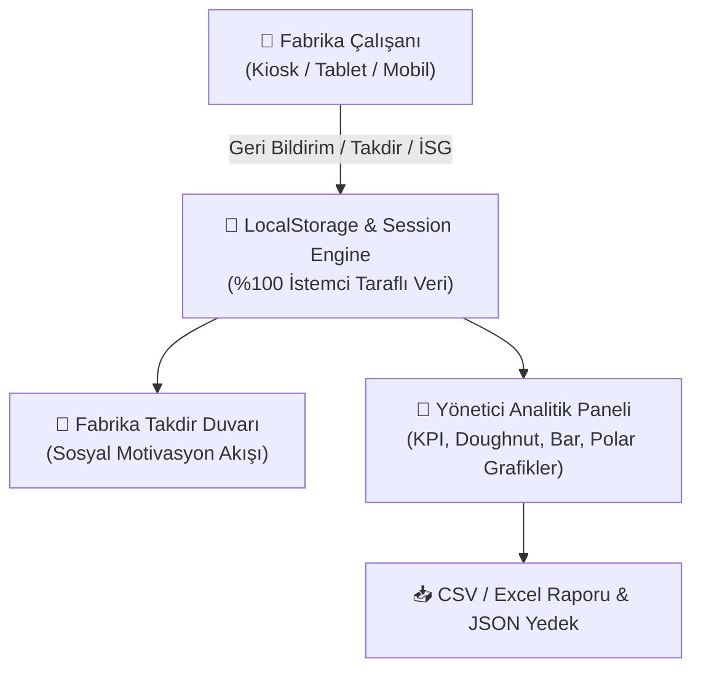

# 🛡️ Safe5 — Fabrika Çalışan Geri Bildirim & Analitik Paneli

> **Canlı Erişim:** 👉 **[https://keremcaliskann.github.io/tools/safe5/](https://keremcaliskann.github.io/tools/safe5/)**

**Safe5**, endüstriyel üretim tesisleri, fabrikalar ve atölyeler için geliştirilmiş; çalışanların birbirine 5S, İSG (İş Sağlığı ve Güvenliği), Kaizen ve Takım Ruhu odaklı yapıcı geri bildirimler ilettiği, fabrika yönetiminin ise bu verileri gerçek zamanlı grafiklerle analiz edebildiği **%100 istemci taraflı (Zero-Backend) ve Local-First** bir web uygulamasıdır.

---

## 🌟 Öne Çıkan Özellikler

### 👷 1. Çalışan Deneyimi (Worker View)
- **⚡ 10 Saniyede Geri Bildirim:** Dokunmatik ekranlara ve kiosk kullanımına uygun, hızlı ve sade geri bildirim formu.
- **🎯 3 Ana Bildirim Türü:**
  - 🌟 **Takdir & Teşekkür (Kudos):** Örnek çalışma, vardiya devri desteği, yüksek motivasyon.
  - 💡 **Kaizen & İyileştirme:** İsrafı önleme, ergonomi, parça ve takım akışı iyileştirmesi.
  - 🦺 **İSG & Güvenlik Bildirimi:** Doğru KKD kullanımı takdiri, ramak kala uyarısı, acil durum hattı emniyeti.
- **🧹 5S ve Endüstriyel Değerler:** 5S Tertip & Düzen, Sıfır Hata, Dayanışma ve Güvenlik kategorileri.
- **🎖️ Takdir Rozetleri:** 🏆 Ayın Yıldızı, 🦺 İSG Öncüsü, 💡 Kaizen Ustası, 🤝 Takım Ruhu, ⚙️ Hızlı Çözüm.
- **🕵️‍♂️ İsteğe Bağlı Anonimlik:** Çalışanların çekinmeden, dürüst ve yapıcı şekilde güvenlik uyarısı ve iyileştirme bildirebilmesi için anonim gönderim seçeneği.
- **🌟 Fabrika Takdir Duvarı (Kudos Wall):** Fabrika içi motivasyonu ve pozitif kültürü canlı tutan akış panosu.

### 👑 2. Yönetici Deneyimi (Admin & Analitik Paneli)
- **📊 Etkileşimli Analiz Grafikleri:**
  - **Kategori Dağılımı (Doughnut):** İSG, 5S, Kaizen ve Takım Çalışması odaklarının dengesi.
  - **Bölüm & Hat Karşılaştırması (Bar Chart):** Montaj, Talaşlı İmalat, Kalite, Bakım, Depo ve Kaynak hatlarının geri bildirim performansı.
  - **Vardiya Analizi (Polar Chart):** 1., 2. ve 3. Vardiya katılım oranları.
  - **🏆 Liderlik Panosu:** En çok takdir alan öncü çalışanlar.
- **📋 Denetim & Aksiyon Yönetimi:** Geri bildirimlere statü atama (`İnceleniyor`, `Aksiyon Alındı / Kaizen Başlatıldı`, `Tamamlandı`).
- **📥 CSV & Excel Raporlama:** UTF-8 BOM destekli Türkçe Excel uyumlu tek tıkla dışa aktarma.
- **💾 JSON Yedekleme & Geri Yükleme:** Fabrika veri tabanını çevrimdışı taşıma ve arşivleme.

---

## 🛠️ Nasıl Çalışır? (Teknik & Mimari Yapı)

1. **Sıfır Sunucu Bağımlılığı (%100 Client-Side):** Veriler hiçbir harici sunucuya iletilmez, tamamen tarayıcının yerel hafızasında (`localStorage`) çalışır.
2. **Çevrimdışı Çalışabilirlik:** İnternet bağlantısı kesilse dahi dahili SVG grafik motoru ve PWA mimarisi sayesinde fabrika zemininde kesintisiz çalışmaya devam eder.
3. **Rol Yönetimi:** Tek tıkla çalışan profilleri veya fabrika yönetimi rolü arasında geçiş yapılabilir.

---

## 🚀 Hızlı Başlangıç

1. [https://keremcaliskann.github.io/tools/safe5/](https://keremcaliskann.github.io/tools/safe5/) adresini açın.
2. Sağ üstteki **"Profil / Rol Değiştir"** butonuyla istediğiniz çalışanı veya **"Fabrika Yöneticisi"** modunu seçin.
3. Çalışan olarak sol taraftaki formu doldurup **"Geri Bildirimi Yayınla"** butonuna basın.
4. Yönetici moduna geçerek fabrika metriklerini, vardiya analizlerini ve KPI sayaçlarını inceleyin.
5. Dilerseniz **"CSV Raporu İndir"** butonuyla Excel tablosu oluşturun.

---

## 📄 Lisans
Bu proje Kerem Çalışkan tarafından açık kaynak felsefesiyle geliştirilmiştir. Tamamen ücretsiz, güvenli ve istemci taraflıdır.
